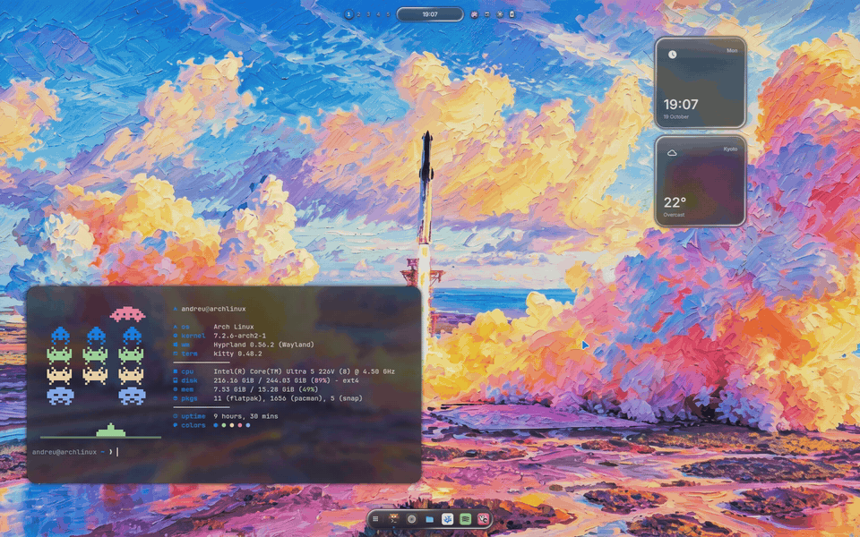
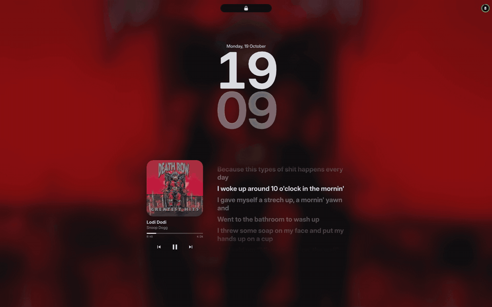

<p align="center">
  
</p>

<p align="center">
  <b>A Hyprland shell whose colours come from a painting.</b><br>
  One black island that changes shape, a desk of widgets under the windows,<br>
  and every program around it repainted by whatever wallpaper is up.
</p>

<p align="center">
  <a href="https://github.com/andreumassanet/impasto/actions/workflows/check.yml"></a>
  
  
  
  <a href="LICENSE"></a>
</p>

<p align="center">
  <a href="https://trendshift.io/repositories/233611"></a>
  <a href="https://trendshift.io/repositories/233611"></a>
</p>

<p align="center">
  <a href="https://andreumassanet.github.io/impasto-docs/"><b>Documentation</b></a> ·
  <a href="#the-island">The island</a> ·
  <a href="#the-bar">The bar</a> ·
  <a href="#liquid-glass">Liquid glass</a> ·
  <a href="#the-desktop">The desktop</a> ·
  <a href="#installation">Installation</a> ·
  <a href="#keys">Keys</a>
</p>

<p align="center">
  
</p>

The name is the technique the wallpapers are painted in: paint laid on thick
enough to keep the mark of the brush. It is a shell first and a dotfiles
repository second — `home/.config/quickshell` is most of the code, and the rest
of `home/` is the desk around it: the terminal, the prompt, two editors, two
file managers, a browser, a chat client, the login screen. **Change the
wallpaper and all of it follows.**

## The island

<p align="center">
  
</p>

**The island is one object that changes shape.** A black capsule in the middle
of the bar rests on the time and turns into everything else: the glance under
the pointer, the control centre, the launcher, the overview, a notification, a
game — each the size of what is in it, with no title and no close button. What
is running sits either side of the time — a countdown, the track, or whatever
is using the microphone, the camera or the screen — and every module on the bar
opens into the island rather than into a popup of its own. A notification
arrives there with its buttons, and stays in the control centre's list.

<p align="center">
  
</p>

## The bar

<p align="center">
  
</p>

**Four styles, one layout.** Pieces are dragged out of a catalogue onto a
picture of the bar, then drawn grouped round the island, spread to the edges,
all inside one capsule, or on a bezel across the top edge that the island
drops out of. The screen's corners can be rounded to match. A module tells you something and opens its detail; a
button opens something — any panel the control centre does, the capture
surface, or Settings. Each shows its symbol or its ring, with its figure
always, never or under the pointer — two settings for the whole bar, and any
piece can have a look of its own. The sides sit in capsules or straight on the
wallpaper, the workspace strip is dots, bars, rings or numbers written out, and
a tray holds the icons applications put there.

**On more than one screen, every screen gets the whole bar**, and the island is
live on the one you are typing on. Each screen keeps widgets and notes of its
own and the dock is on all of them, a workspace number brings that workspace to
the screen you are on, and the brightness keys dim that screen — an external
monitor over DDC/CI.

## Liquid glass

<p align="center">
  
</p>

**Every layer can be glass.** The island and the bar, the dock, the widgets and
the terminal each take a ground of their own: classic black, glass, or liquid —
a clear pane lit from one side, with the painting showing through in its own
colours. The windows can refract what is behind them as well, bending the
wallpaper at their edges.

## The desktop

<p align="center">
  
</p>

**The palette comes out of the painting.** Pick a wallpaper and its colours
reach everything at once: the island and the widgets, the terminal, neovim,
VSCodium, the GTK and Qt windows, Nautilus down to its folders, Vesktop, Zen
and Spotify. Forty paintings come with it, and a video can be the wallpaper
too.

**Any module can live on the wallpaper**, on a grid, in four shapes, drawn in
one of three themes: *Modern*, *Analogue* or *Sticker*. Right-click the
wallpaper to arrange it.

## Notes and tasks

<p align="center">
  
</p>

**A note is paper**: a pastel square with a title and the body in handwriting.
`SUPER + S` opens the deck; on the wallpaper a note sits on a square, or stacks
with others along an edge as tabs that peek out under the pointer.

**A board for what has to be done.** `SUPER + K` is to do, doing, done, with
cards dragged between the lanes, and a task's day shows as a dot under the
month wherever a month is drawn.

## Games and pets

<p align="center">
  
</p>

**Eleven small games, played in the island** — `SUPER + G` opens a shelf, and
the island becomes the board. **A family of five small creatures lives on the
bar**: one out at a time, earning levels from being fed and played with, each
hatched from an egg and drawn in one of four styles. Nothing dies, and a week
away costs nothing.

## Lock and login

<p align="center">
  
</p>

**The shell locks the session itself**, over the blurred desk, and the login
screen is the same lock with the desk taken away: an SDDM theme with the same
island, the same clock and the same pill, over a blurred painting. Both rest on
the clock alone. When something is playing, the lock shows it: the cover
blurred behind everything, and the lyrics beside it, line by line in time with
the track. Any key brings in your account and the field, and is already
the first letter of your password; Escape sends them away again. The clock is
stacked or on one line, in Settings → Session → Lock screen, and the login
screen always stacks it. The picture and the name are your account's, and
Settings → Session changes them for both screens at once: drop an image on the
card and it is made square and kept where the login screen reads it; type a
name and it becomes the account's full name.

**With an infrared camera, the lock opens for your face.** Touch a key or the
pointer and the island grows under the camera, a ring turns around its
padlock while it looks, closes green, the padlock opens and the blur lifts off
the desk. It is its own conversation beside the password, so a face it does
not know never costs you a try, and the login screen still asks for the
password after a boot. Settings → Session lists the faces it knows, adds
another, removes one, and lets you try it without locking.

**Before either of them, the boot.** A Plymouth splash over the same blurred
painting: the palette board and the name in the middle, and a daub of paint
lands on the board for every fifth of the way. An encrypted disk asks for its
password with the login screen's island and pill, and shutting down shows the
board fully painted.

**The webcam has effects for any call.** <kbd>SUPER</kbd> <kbd>SHIFT</kbd>
<kbd>W</kbd> opens it on the island: what the others will see, a strip of
effects under it (the palette's colour, black and white, the background
blurred, centre stage, sunglasses, a crown) and the gestures beside it. A
thumbs up lets balloons go, a heart made with both hands sends hearts, a
victory sign throws confetti. Pick *impasto camera* in Discord, a browser or
OBS; the webcam turns on only while one of them is reading it.

## Installation

Arch Linux, and Hyprland 0.56 or newer (tested on 0.56.2), configured in Lua.
Run it from a terminal, in the Hyprland session or on a console before there
is one. The two plugins are built against the compositor that is running, so
from a console the first session opens a terminal that builds them:

```bash
git clone https://github.com/andreumassanet/impasto.git ~/impasto
cd ~/impasto
./setup install
```

It installs the packages it is missing — upgrading the system in the same step,
as Arch asks — oh-my-zsh, everything in `home/` into your home and everything
in `system/` into `/`, the two Hyprland plugins and the vector cursor, and the
login screen, switched on unless your machine already uses another display
manager. It sets up Nautilus, VSCodium, Vesktop and Spotify, dark GTK
applications, and what opens which kind of file — leaving alone any your
machine already has an answer for. Where there is an infrared camera it
installs howdy-next and asks to enrol your face, and where there is a webcam
it installs the virtual camera the effects go out through. It turns the boot
splash on, which rebuilds the initramfs once. It asks for your password
through sudo for pacman, for the copy into `/`, and to let spicetify patch
Spotify. A program that is open, or a Spotify you have never started, is
skipped with the reason and set up by the next `update`. After that they follow
the wallpaper on their own; Spotify from its next start.

Run `./setup` with nothing after it and it asks instead: the verbs on one
screen, and what an install may leave out on the next, which is the flags below
with somewhere to press them.

| Flag | |
|---|---|
| `--skip-packages` | install nothing; copy and build only |
| `--skip-system` | leave `/` alone — no login screen, and no password for it |
| `--skip-plugins` | no shake to find, no glass |
| `--skip-extras` | leave Nautilus, VSCodium, Vesktop, Spotify, GTK, face unlock, the camera and the boot splash alone |
| `--aur-helper yay\|paru` | which helper builds the AUR half — built from the AUR if you have neither |
| `--noconfirm` | take the default at every question |
| `-n`, `--dry-run` | say what would happen, and do none of it |

```bash
./setup update       # git pull, then install again — the same flags
./setup uninstall    # remove what it installed, and put back what it moved aside
./setup help         # every verb and flag
```

`update` follows the branch you cloned: `main` moves only when a version is
released, and work in progress lives on `dev`. The version installed is under
Settings → System, with what the branch has waiting since it and a button that
runs `update` in a terminal.

**Nothing is linked: `setup` copies**, and remembers what it wrote. A file of
yours already in the way is moved to `~/.local/state/impasto/backups/` first; a
file you edit afterwards is left alone, with the new version beside it as
`<name>.new`, and one you delete stays deleted — the wallpapers you do not want,
say. Settings → System lists both, each with a button to put impasto's version
back. Editing the repository itself? `./setup sync` copies it onto the
desk, and `./setup sync --watch` keeps doing it on every save.

Every package is listed in `packages/pacman.txt` and `packages/aur.txt`, grouped
by what it is for; an optional one that is missing takes its own control away
rather than failing.

<details>
<summary><b>Components</b></summary>
<br>

| | | |
|---|---|---|
| 🪟 | Compositor | [Hyprland](https://hypr.land) |
| 🖱️ | Shake to find | [hypr-dynamic-cursors](https://github.com/VirtCode/hypr-dynamic-cursors) |
| 🫧 | Glass on the windows | [hyprglass](https://github.com/hyprnux/hyprglass) |
| 🐚 | Desktop shell | [Quickshell](https://quickshell.org) |
| 🖼️ | Wallpaper daemon | [awww](https://github.com/LGFae/swww) |
| 🖥️ | Terminal | [kitty](https://sw.kovidgoyal.net/kitty/) |
| ⌨️ | Interactive shell | [zsh](https://www.zsh.org) · [oh-my-zsh](https://ohmyz.sh) |
| ❯ | Prompt | [starship](https://starship.rs) |
| 🎨 | Greeting | [fastfetch](https://github.com/fastfetch-cli/fastfetch) |
| 📊 | System monitor | [btop](https://github.com/aristocratos/btop) |
| 🎵 | Audio visualiser | [cava](https://github.com/karlstav/cava) |
| 📁 | File manager | [yazi](https://yazi-rs.github.io) |
| 🗂️ | File manager in a window | [Nautilus](https://apps.gnome.org/Nautilus/) |
| ✏️ | Editor | [neovim](https://neovim.io) |
| 📝 | Editor in a window | [VSCodium](https://vscodium.com) |
| 🖼️ | Image viewer | [imv](https://sr.ht/~exec64/imv/) |
| 🪄 | Annotator | [satty](https://github.com/gabm/Satty) |
| 💬 | Chat | [Vesktop](https://github.com/Vencord/Vesktop) |
| 🎧 | Player | [Spotify](https://www.spotify.com) · [spicetify](https://spicetify.app) |
| 🌐 | Browser | [Zen](https://zen-browser.app) |
| 🔆 | Monitor brightness | [ddcutil](https://www.ddcutil.com) |
| 🔑 | Login screen | [SDDM](https://github.com/sddm/sddm) |
| 🎨 | Boot splash | [Plymouth](https://gitlab.freedesktop.org/plymouth/plymouth) |
| 👤 | Face unlock | [howdy-next](https://codeberg.org/nathawat/howdy-next) |
| 📷 | Camera effects | [MediaPipe](https://ai.google.dev/edge/mediapipe) · [v4l2loopback](https://github.com/umlaeute/v4l2loopback) |

</details>

## Keys

Every key belongs to a profile: Settings → Keys changes any of them, the
compositor's included, and switching profile switches them all. A few worth
knowing first:

- <kbd>SUPER</kbd> <kbd>Return</kbd> a terminal, <kbd>SUPER</kbd> <kbd>Space</kbd>
  the launcher, <kbd>SUPER</kbd> <kbd>Q</kbd> closes the window
- <kbd>SUPER</kbd> <kbd>1</kbd>…<kbd>0</kbd> a workspace, on the screen you are
  on, <kbd>SUPER</kbd> <kbd>TAB</kbd> all of them at once
- <kbd>SUPER</kbd> <kbd>ALT</kbd> <kbd>←</kbd> <kbd>→</kbd> the other screen,
  adding <kbd>SHIFT</kbd> takes the workspace with you
- <kbd>SUPER</kbd> <kbd>X</kbd> the session menu, <kbd>SUPER</kbd> <kbd>L</kbd>
  locks
- <kbd>SUPER</kbd> <kbd>H</kbd> every other key, on the island

## Credits

These are worth your time whether or not you use this repository. No code was
copied from any of them; what carried over from the shells are ideas — one file
per island state, one transient signal for every ephemeral event, input
debounced to one frame, and a capture that photographs the screen and draws the
selection on the photograph.

- [saneAspect](https://www.youtube.com/@saneAspect) — the Hyprland setups on
  YouTube that started all this
- [Tide-island](https://github.com/enhaoswen/Tide-island) — the closest thing to
  a complete dynamic island for Hyprland
- [ChillPill-Shell](https://github.com/LUCKYS1NGHH/ChillPill-Shell) — a dynamic
  pill bar built to stay light without a dedicated GPU
- [k4](https://github.com/k4ditano/k4) — a dynamic island bar with a documented
  plugin API
- [HyprQuickshot](https://github.com/JamDon2/hyprquickshot) and its fork
  [HyprQuickFrame](https://github.com/Ronin-CK/HyprQuickFrame) — a capture
  surface in Quickshell
- [diegoMalagrida/dotfiles](https://github.com/diegoMalagrida/dotfiles) — an
  Arch Linux desk ready to install on a fresh system

Built on [Quickshell](https://quickshell.org) and [Hyprland](https://hypr.land).
The pointer is [Bibata](https://github.com/ful1e5/Bibata_Cursor), repainted;
the folders are [Papirus](https://github.com/PapirusDevelopmentTeam/papirus-icon-theme),
re-pointed; the type is [Inter](https://rsms.me/inter/) and
[JetBrains Mono](https://www.jetbrains.com/lp/mono/). Six of the nine palettes
are other people's work, carried as they are:
[Catppuccin](https://catppuccin.com) Mocha and Latte,
[Tokyo Night](https://github.com/folke/tokyonight.nvim),
[Gruvbox](https://github.com/morhetz/gruvbox), [Nord](https://www.nordtheme.com)
and [Rosé Pine](https://rosepinetheme.com).

## Star history

<a href="https://star-history.com/#andreumassanet/impasto&Date">
  <picture>
    <source media="(prefers-color-scheme: dark)" srcset="https://api.star-history.com/svg?repos=andreumassanet/impasto&type=Date&theme=dark">
    
  </picture>
</a>

## License

Copyright © 2026 Andreu Massanet — released under the [GNU GPL-3.0](LICENSE).

You may use, study, change and share any of it. If you build on it and pass the
result on, it stays under the GPL and its source stays available. Keep the
header at the top of each file, which carries this repository's address, and a
line of credit back here is the kind thing to do.
